# TCExam — Comprehensive User & Administrator Guide

Welcome to the **TCExam User Guide**. TCExam is a modern, enterprise-ready Computer-Based Assessment (CBA / CBT) system engineered to simplify, automate, and secure the examination and evaluation process for schools, universities, certification bodies, and corporations.

---

## Table of Contents

1. [System Architecture & Concepts](#1-system-architecture--concepts)
2. [User Roles, Levels & Capabilities](#2-user-roles-levels--capabilities)
3. [Question & Content Authoring](#3-question--content-authoring)
   - [Modules and Topics](#modules-and-topics)
   - [Question Types](#question-types)
   - [TCEcode Formatting & Media](#tcecode-formatting--media)
   - [Step-by-Step Example: Creating a Question Set](#step-by-step-example-creating-a-question-set)
4. [Exam & Test Management](#4-exam--test-management)
   - [Test Settings & Security Options](#test-settings--security-options)
   - [Dynamic Question Subsets Manager](#dynamic-question-subsets-manager)
   - [Step-by-Step Example: Configuring a Certification Exam](#step-by-step-example-configuring-a-certification-exam)
5. [Candidate Exam-Taking Experience](#5-candidate-exam-taking-experience)
   - [Candidate Portal Overview](#candidate-portal-overview)
   - [Interactive Exam Interface](#interactive-exam-interface)
   - [Question Palette & Flag for Review](#question-palette--flag-for-review)
   - [Smart Timer & Urgency Alerts](#smart-timer--urgency-alerts)
   - [Pre-Submission Review & Exam Submission](#pre-submission-review--exam-submission)
6. [Grading, Ratings & Results](#6-grading-ratings--results)
   - [Automatic vs. Manual Grading](#automatic-vs-manual-grading)
   - [Rating Free-Text Essay Questions](#rating-free-text-essay-questions)
   - [Answer-Key Protection & Security](#answer-key-protection--security)
   - [Candidate Post-Exam Review & History](#candidate-post-exam-review--history)
7. [Reporting, Analytics & Exports](#7-reporting-analytics--exports)
   - [Statistical Analytics & Performance Breakdown](#statistical-analytics--performance-breakdown)
   - [PDF Transcripts & Reports](#pdf-transcripts--reports)
   - [TSV & XML Data Exports](#tsv--xml-data-exports)
8. [User & Group Administration](#8-user--group-administration)
   - [Group Architecture](#group-architecture)
   - [User Management & Capability Allocation](#user-management--capability-allocation)
   - [Bulk Operations & Importers](#bulk-operations--importers)
   - [System Backups & Database Tools](#system-backups--database-tools)
9. [Troubleshooting & Best Practices](#9-troubleshooting--best-practices)

---

## 1. System Architecture & Concepts

TCExam structures examination content in an intuitive, hierarchical relational model:

```
Modules (Top-level academic disciplines or subjects)
  └── Topics / Subjects (Specific focus areas or chapters)
        └── Questions (Individual assessment items)
              └── Answers (Options, alternatives, or rubric criteria)

Tests (Exams configured for delivery)
  ├── Test Subsets (Rules pulling X questions of difficulty Y from Topic Z)
  └── Assigned Groups (Candidate rosters authorized to sit for the exam)
```

### Access Portals
* **Candidate Portal (`/public/code/`)**: Clean, accessible portal where candidates log in, launch assigned tests, navigate questions with real-time saving, monitor timers, and review completed exam transcripts.
* **Administrative Portal (`/admin/code/`)**: Back-office suite where content creators author questions, examiners build tests, instructors grade free-text answers, and administrators manage users and view organization-wide reports.

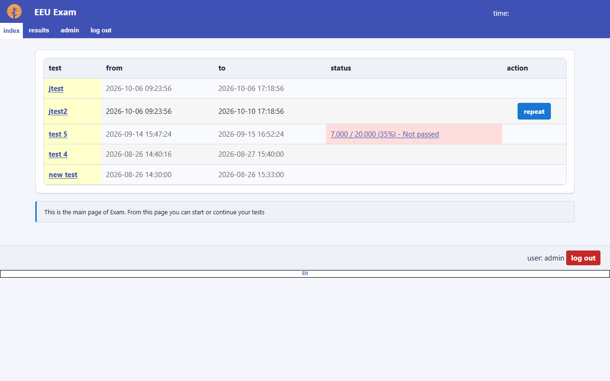
*Figure 1: Candidate Portal dashboard displaying active exams, test history, and status.*

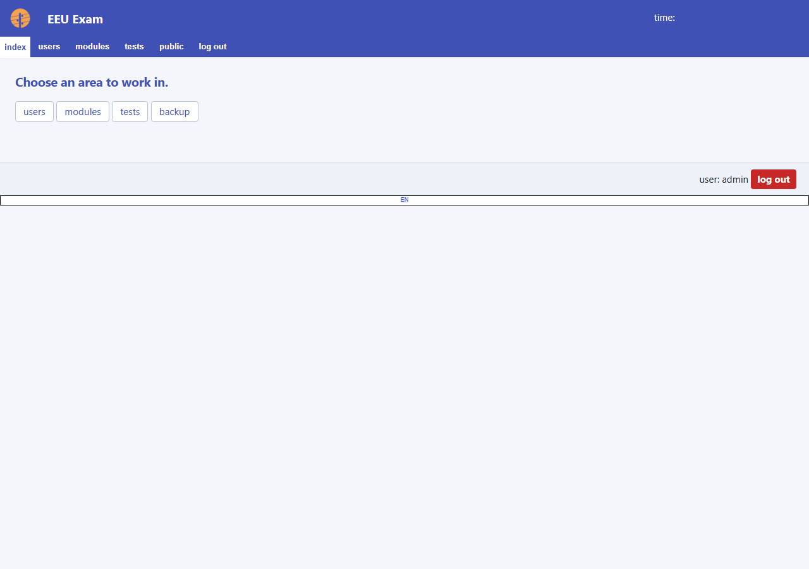
*Figure 2: Administrative Back-Office dashboard with quick access to modules, tests, ratings, and user management.*

---

## 2. User Roles, Levels & Capabilities

TCExam features a **two-tier authorization model**:
1. **Vertical Rank (User Level 0 to 10)**: Governs hierarchical precedence (e.g., an administrator can only edit accounts with a level strictly lower than their own).
2. **Horizontal Capabilities (`K_PERM_*` Bitmask)**: Independent permission bits that determine exactly what actions a user can perform.

### Standard System Roles

| Level | Role Name | Capability Bitmask | Description |
| :---: | :--- | :--- | :--- |
| **0** | **Anonymous / Guest** | None | Unauthenticated public visitor. |
| **1** | **Candidate / Student** | None | Takes assigned tests and reviews personal results. |
| **2** | **Content Viewer** | `VIEW_CONTENT` | Read-only reviewer for question banks. |
| **3** | **Content Author** | `VIEW_CONTENT` + `EDIT_CONTENT` | Authors modules, topics, questions, and answers. |
| **5** | **Examiner / Operator** | `VIEW_CONTENT` + `EDIT_CONTENT` + `OPERATOR` | Creates exams, rates answers, and analyzes results. |
| **6** | **Identity Admin** | `OPERATOR` + `MANAGE_IDENTITY` | Globally manages candidate accounts and groups. |
| **9** | **Site Administrator** | All except `ADMIN` (`+ BACKUP`, `+ GLOBAL_VIEW`) | Full management plus database backups and cross-group views. |
| **10** | **System Superadmin** | `ALL` (127) | Complete, unrestricted system access. |

### Smart Auto-Sync in User Management
When editing an account in **Users > User Editor** (`tce_edit_user.php`), selecting a **Level** automatically checks the recommended capability checkboxes for that role. You can also click **[apply level preset]** to restore default capability bits at any time.

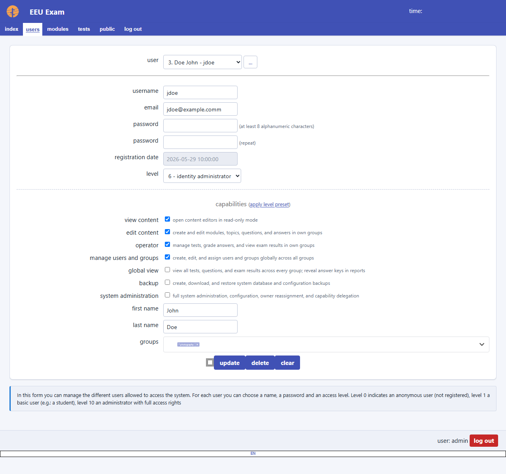
*Figure 3: User Editor interface displaying vertical user levels, the auto-sync preset trigger, and inline capability tooltips/descriptions.*

---

## 3. Question & Content Authoring

### Modules and Topics
Content is grouped in two levels:
* **Module**: Broad subject (e.g., *"Information Technology"*).
* **Topic (Subject)**: Focused sub-discipline (e.g., *"Computer Networks"*, *"Relational Databases"*).

### Question Types

TCExam supports four distinct question types:

1. **Type 1: MCSA (Multiple Choice Single Answer)**
   - Only **one** answer can be correct.
   - Rendered with radio buttons and circular letter badges (`[ A ]`, `[ B ]`, `[ C ]`, `[ D ]`).
   - Includes a **Clear Selection** link to allow deselecting options if the test-taker changes their mind.
2. **Type 2: MCMA (Multiple Choice Multiple Answer)**
   - **One or more** answers can be correct.
   - Rendered with checkboxes and letter badges (`[ A ]`, `[ B ]`, `[ C ]`, `[ D ]`).
   - Supports partial scoring (points awarded for each correctly checked/unchecked option).
3. **Type 3: TEXT (Free-Text / Essay / Short Answer)**
   - Candidate types open-ended text in an auto-expanding text box.
   - Scored manually by an examiner via the Rating Editor (`admin/code/tce_edit_rating.php`).
4. **Type 4: ORDER (Ordering / Sequence)**
   - Candidate ranks items into chronological or numerical sequence using select dropdowns.
   - Scored automatically by checking the permutation of selected positions.

### TCEcode Formatting & Media
Questions and answers support **TCEcode** (BBCode-style markup with enhanced mathematical and multimedia syntax):

```bbcode
[b]Bold text[/b], [i]Italic text[/i], [u]Underlined[/u]
[code]SELECT * FROM users WHERE active = 1;[/code]
[color=#28a745]Colored text[/color]
[small]Small text[/small]
[url=https://example.com]External Link[/url]
```

To embed multimedia (images, audio, video):
1. Upload media in **Modules > File Manager** (`tce_filemanager.php`).
2. Link the uploaded media using the **[select file]** button next to the question or answer description field.

---

### Step-by-Step Example: Creating a Question Set

Let's author a question in the topic *"Relational Databases"*:

#### 1. Create the Question
1. Navigate to **Modules > Questions** (`admin/code/tce_edit_question.php`).
2. Select your Module (*"Information Technology"*) and Topic (*"Relational Databases"*).
3. Set **Type** to `1: MCSA - Single Answer`.
4. Set **Difficulty** to `2` (Normal).
5. In **Description**, enter:
   ```bbcode
   Which SQL clause is used to filter records [b]after[/b] an aggregation has been performed with [code]GROUP BY[/code]?
   ```
6. In **Explanation**, enter:
   ```bbcode
   The [code]HAVING[/code] clause filters rows after aggregation, whereas [code]WHERE[/code] filters rows before aggregation.
   ```
7. Click **Add**. Note the generated Question ID.

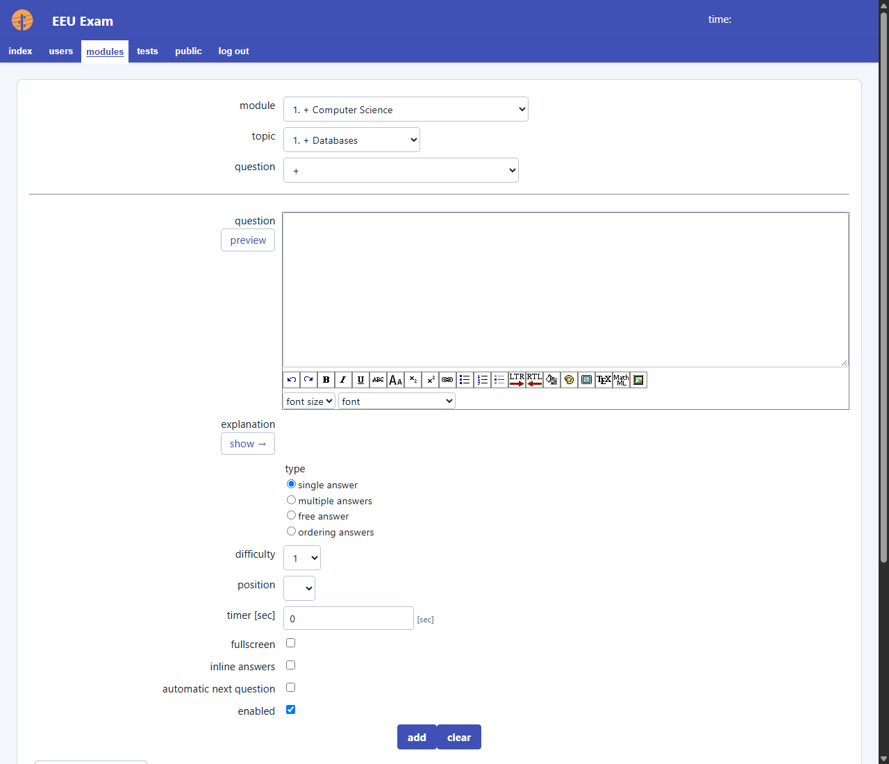
*Figure 4: Question Editor featuring the TCEcode rich-text formatting bar, difficulty rating, and question type selector.*

#### 2. Add Answers
1. In the Question Editor, click **[answers]** or go to **Modules > Answers** (`admin/code/tce_edit_answer.php`).
2. Add Option 1:
   - Description: `WHERE`
   - Correctness: Uncheck **Right**
   - Click **Add**.
3. Add Option 2:
   - Description: `HAVING`
   - Correctness: Check **Right**
   - Click **Add**.
4. Add Option 3:
   - Description: `ORDER BY`
   - Correctness: Uncheck **Right**
   - Click **Add**.
5. Add Option 4:
   - Description: `PARTITION BY`
   - Correctness: Uncheck **Right**
   - Click **Add**.

---

## 4. Exam & Test Management

### Test Settings & Security Options

Navigate to **Tests > Tests** (`admin/code/tce_edit_test.php`) to configure an exam:

* **Basic Information**:
  - **Name**: e.g. *"Database Engineering Midterm"*.
  - **Description**: Candidate instructions displayed on the exam launchpad.
  - **Validity Period**: `Begin Time` and `End Time` windows.
  - **Duration**: Test timer limit in minutes (e.g. `60`).
  - **Pass Percentage**: Minimum score required to pass (e.g. `70%`).
* **Scoring Rules**:
  - **Score Right**: Points awarded for a correct answer (e.g. `2.0`).
  - **Score Wrong**: Negative marking / penalty for an incorrect answer (e.g. `-0.5` or `0.0`).
  - **Score Unanswered**: Points awarded/deducted for unanswered questions (normally `0.0`).
* **Security & Execution Controls**:
  - **Random Questions**: Randomizes question order for each candidate.
  - **Random Answers**: Shuffles answer choices per question.
  - **Display Results to Users**: Enables immediate score breakdown on submission.
  - **Repeatable**: Number of permitted attempts.
  - **IP Range Lock**: Restricts exam access to laboratory subnets (e.g. `192.168.1.0/24`).
  - **Password**: Requires an exam-hall proctor passcode to begin.

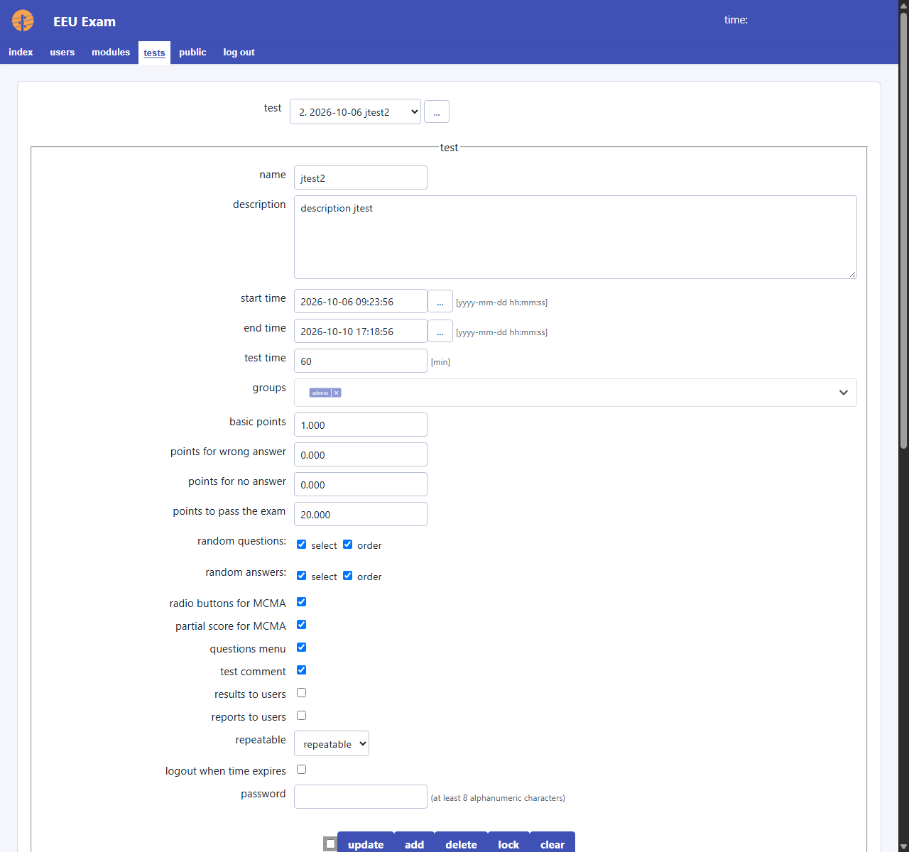
*Figure 5: Test configuration interface with timing parameters, scoring rules, and security options.*

---

### Dynamic Question Subsets Manager

Under the test configuration form, the **Question Subsets** manager allows you to construct exam blueprints:

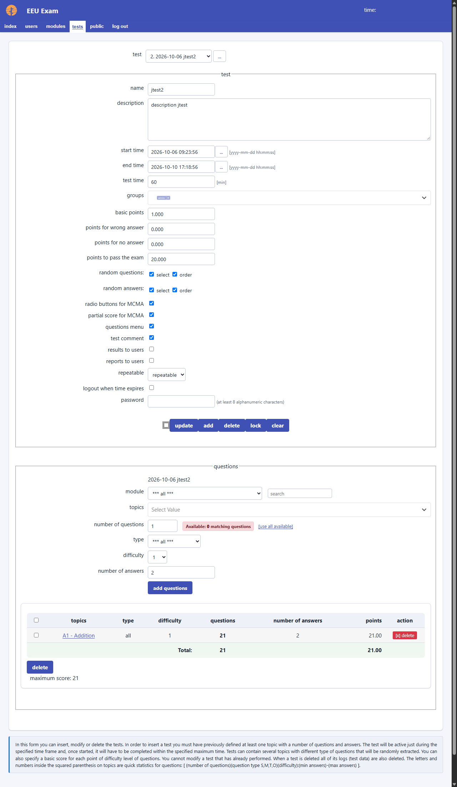
*Figure 6: Dynamic Subsets Manager with module filter, live availability indicator, [use all available] button, and the structured Subsets Summary Table.*

#### Features of the Subsets Manager:
* **Module Filter & Live Search**: Filter the topic dropdown by module or type into the real-time search box to find specific topics in large question banks.
* **Topic Question Counters**: Each topic displays total question availability: `Topic Name (24 questions)`.
* **Live Availability Badge**: As soon as you select a question type and difficulty, the availability badge shows exactly how many matching questions exist in the database (e.g., `Available: 15`).
* **[use all available] Quick Fill**: Click this button to instantly populate the quantity field with all available matching questions.
* **Structured Subsets Summary Table**: Configured subsets are presented in a clean table showing Topic, Question Type, Difficulty, Question Count, Answers per Question, Points, and direct **1-click [x] delete** buttons.
* **Form Auto-Reset & F5 Safety**: Adding a subset immediately resets the form to a clean state, and browser history state replacement prevents duplicate entries on page refreshes.

---

### Step-by-Step Example: Configuring a Certification Exam

Let's configure a 60-minute certification test composed of two topics:

1. **Create the Test Header**:
   - Name: `SQL & Networking Fundamentals`
   - Duration: `60` minutes
   - Score Right: `1.0`, Score Wrong: `0.0`, Pass %: `70%`
   - Check **Random Questions** and **Random Answers**.
   - Click **Add**.
2. **Add Topic 1 Subsets**:
   - Filter by Module: *"Information Technology"*.
   - Select Topic: *"Relational Databases"*.
   - Select Question Type: `1: MCSA - Single Answer`.
   - Select Difficulty: `2`.
   - Quantity: `15`.
   - Answers: `4`.
   - Click **Add Questions**.
3. **Add Topic 2 Subsets**:
   - Select Topic: *"Computer Networks"*.
   - Select Question Type: `1: MCSA - Single Answer`.
   - Select Difficulty: `2`.
   - Quantity: `15`.
   - Answers: `4`.
   - Click **Add Questions**.
4. **Assign Candidate Groups**:
   - In the **Test Groups** section, check the target student group (e.g. *"Class 2026-IT"*).
   - Click **Update**.

The test is now active, authorized for the assigned group, and ready for candidates!

---

## 5. Candidate Exam-Taking Experience

### Candidate Portal Overview
Candidates access their portal at `/public/code/index.php`.

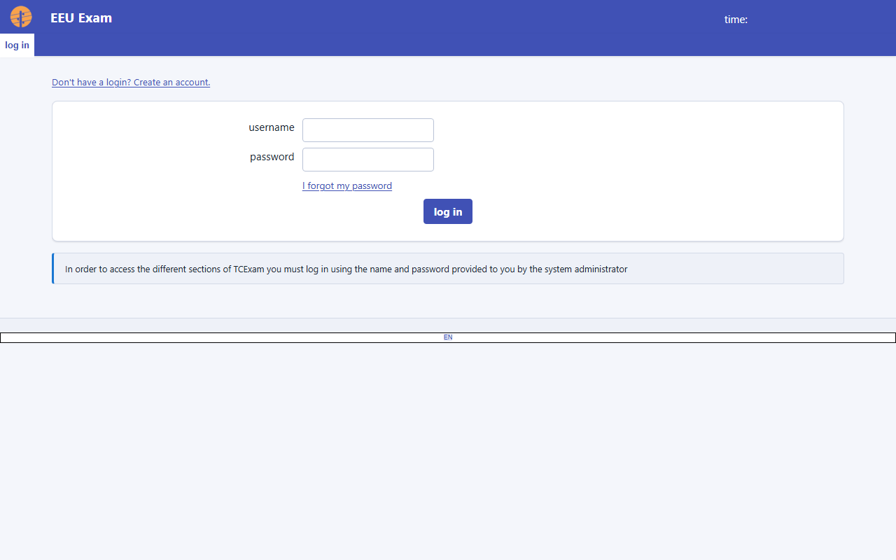
*Figure 7: Secure Candidate Login portal.*

After logging in, the home screen displays all active exams for which they are authorized.

Clicking **Execute** opens the exam launchpad (`tce_test_start.php`), which provides exam parameters:
- Available time and duration.
- Number of questions.
- Scoring rules (points for right, penalties for wrong).
- Pass percentage threshold.

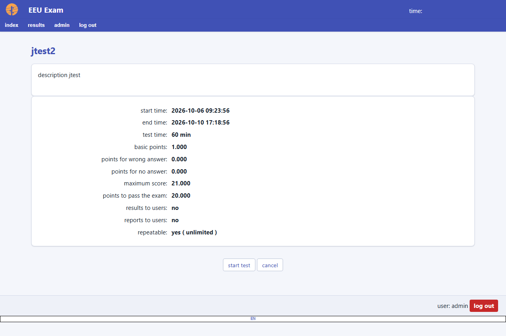
*Figure 8: Exam Launchpad detailing test duration, question counts, and scoring rubric before commencement.*

Clicking **Start Test** begins the assessment.

---

### Interactive Exam Interface

The test-taking screen (`tce_test_execute.php`) is built for focus, speed, and reliability:

```
┌─────────────────────────────────────────────────────────────────────────────┐
│ EXAM TITLE          Question 4 of 30   [==== 13% ====]   [⏱ 54:12]  [End Exam »] │  ← Sticky Header
├─────────────────────────────────────────────────────────────────────────────┤
│ Question 4:                                                                 │
│ What is the default port used by HTTPS connections?                         │
│                                                                             │
│   [ A ]  21                                                                 │
│   [ B ]  80                                                                 │
│   ◉ [ C ]  443                                                              │
│   [ D ]  8080                                                               │
│                                                                             │
│   [ Clear Selection ]                                                       │
├─────────────────────────────────────────────────────────────────────────────┤
│ [« Previous]   [⚑ Flag for Review]   [Next »]                               │  ← Action Bar
├─────────────────────────────────────────────────────────────────────────────┤
│ QUESTION PALETTE (1 Answered, 28 Unanswered, 1 Flagged)                     │
│ [ 1 ✓] [ 2 ] [ 3 ] [ 4 ⚑] [ 5 ] [ 6 ] [ 7 ] [ 8 ] [ 9 ] [ 10 ] ...          │  ← Palette Grid
└─────────────────────────────────────────────────────────────────────────────┘
```

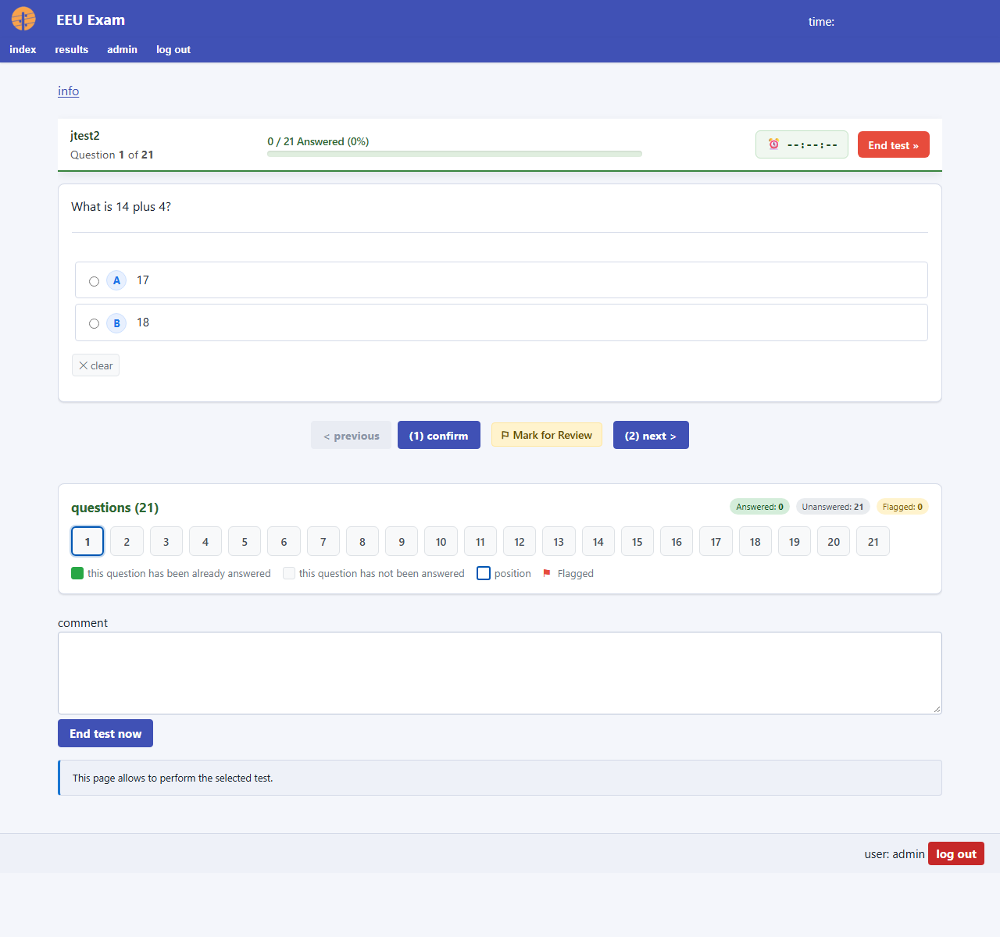
*Figure 9: Live assessment interface featuring sticky header with progress indicator, countdown timer, high-contrast letter badges (`[ A ]`, `[ B ]`), selection clearing link, and Question Palette.*

#### Key Capabilities:

1. **Sticky Status & Progress Header**:
   - Follows the user as they scroll.
   - Displays real-time progress: current question index (`Question X of Y`) and a animated green percentage bar.
   - Contains the live countdown timer and a quick **End Exam »** button.

2. **Smart Urgency Timer**:
   - Runs in real-time without freezing.
   - Displays gentle styling during normal testing.
   - At **< 5 minutes remaining**, enters **Warning State** (amber pulsating glow).
   - At **< 60 seconds remaining**, enters **Critical State** (red pulsating glow with high-contrast text).
   - Automatically auto-submits answers and concludes the test when time expires.

3. **Question Palette Grid**:
   - Displays numbered chips for every question in the test.
   - Color-coded in real-time:
     - 🟢 **Green (`chip_answered`)**: Question has been answered.
     - ⚪ **Neutral (`chip_unanswered`)**: Question has not yet been answered.
     - 🔵 **Blue outline (`chip_current`)**: The question currently on screen.
     - 🟡 **Yellow with flag badge (`chip_flagged`)**: Marked for later review.
   - **Clicking any chip immediately auto-saves the current answer** and jumps directly to that question.

4. **Option Letter Badges & Selection Clearing**:
   - Every multiple-choice option features a clean, high-contrast letter badge (`[ A ]`, `[ B ]`, `[ C ]`, `[ D ]`).
   - Browser duplicate numbering (`1. [ A ]`) is cleanly suppressed.
   - Single-choice questions include a **Clear Selection** link, allowing candidates to reset an answer to unanswered without being forced to choose another option.

5. **Flag for Review**:
   - Clicking **[⚑ Flag for Review]** bookmarks uncertain questions.
   - Synchronized across server sessions and client `localStorage` so flags persist across navigations and accidental refreshes.

---

### Pre-Submission Review & Exam Submission

Candidates have full visibility before submitting:

1. **Interactive Review Modal**:
   - Clicking **End Exam »** in the header or navigation opens a structured review modal.
   - Displays live stat cards: **Answered Questions**, **Unanswered Questions**, and **Flagged for Review**.
   - If questions remain unanswered or flagged, interactive jump chips allow jumping back to any missed question with a single click.
2. **Confirmation Screen**:
   - Candidates must explicitly confirm final submission.
   - Upon confirmation, all answers are locked, timestamps recorded, and automated grading is calculated immediately.

---

## 6. Grading, Ratings & Results

### Automatic vs. Manual Grading
* **Objective Questions (MCSA, MCMA, Order)**: Evaluated immediately upon test completion using server-side scoring algorithms.
* **Subjective Questions (Free-Text / Essay)**: Stored in an ungraded state until evaluated by an authorized instructor.

---

### Rating Free-Text Essay Questions

Instructors grade subjective responses in **Tests > Rating** (`admin/code/tce_edit_rating.php`):

1. Select the **Test** from the dropdown.
2. The queue displays candidate essay responses alongside the official reference explanation and rubric guidelines.
3. Review the candidate's submitted answer.
4. Enter the awarded score in the **Score** field.
   > [!NOTE]
   > The system enforces authoritative server-side boundary checks: scores cannot exceed `test_score_right × question_difficulty`.
5. Enter instructor feedback in the **Comment** field (optional).
6. Click **Update**. The candidate's final exam total is automatically recalculated.

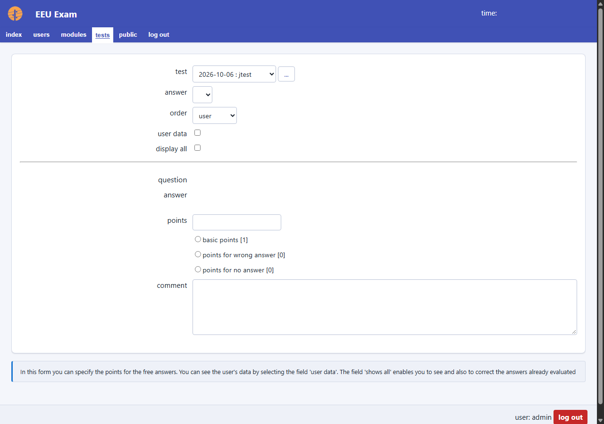
*Figure 10: Subjective evaluation interface for scoring free-text essays against rubric criteria.*

---

### Answer-Key Protection & Security

To prevent unauthorized exposure of test questions and solutions, TCExam features **author-based answer key protection** (`F_canSeeAnswerKeys()`):

* **During the Exam**: Correct answers are strictly hidden from candidate network payloads.
* **Post-Exam Review**:
  - Candidates view their own awarded score, pass/fail status, and their submitted answers.
  - Correct answers and answer explanations are **hidden** from candidates and non-author operators unless the system administrator explicitly enables `K_RESTRICT_ANSWER_KEYS = false`.
  - Question authors and Global View administrators retain full access to answer keys and statistical breakdowns.

---

### Candidate Post-Exam Review & History

If `test_results_to_users` is enabled in test settings:
1. Upon submitting, candidates are immediately redirected to **Post-Exam Results** (`public/code/tce_test_results.php`).
2. Candidates view:
   - Overall Score, Percentage, and Pass/Fail status.
   - Time taken vs. allocated duration.
   - Per-question breakdown (with letter badges `[ A ]`, `[ B ]` matching the exam screen).
3. Candidates can revisit past exams at any time via **All Results** (`public/code/tce_test_allresults.php`), featuring score progression charts and downloadable PDF transcripts.

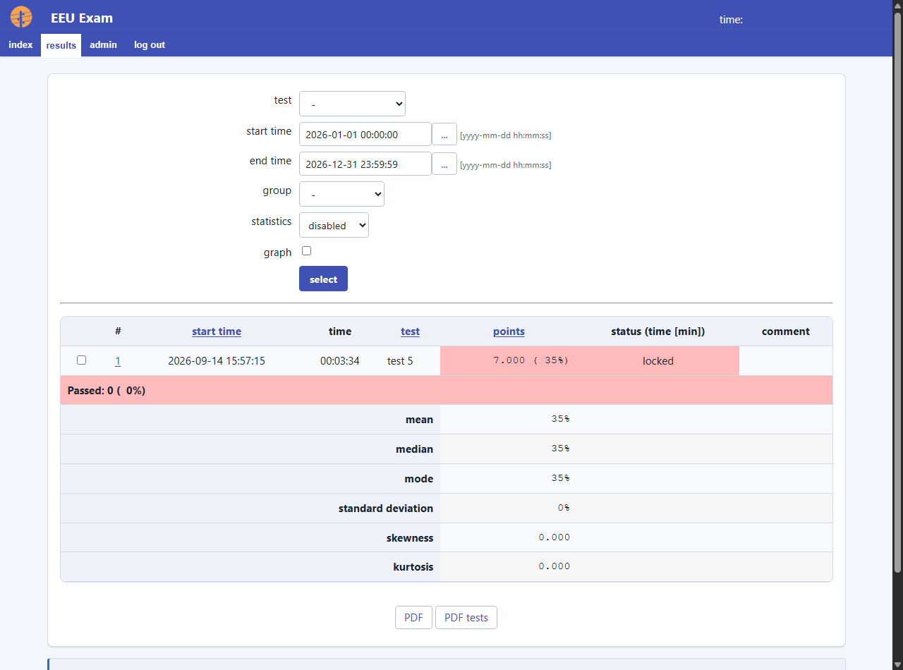
*Figure 11: Candidate results history showing completed exam records, aggregate performance metrics, and official PDF transcript exports.*

---

## 7. Reporting, Analytics & Exports

### Statistical Analytics & Performance Breakdown

Examiners have access to rich performance diagnostics in **Tests > Results** (`admin/code/tce_show_result_allusers.php`):

* **Candidate Roster Table**: View scores, percentages, duration, and pass/fail status filterable by Group, Test, and Date Range.
* **Score Distribution Charts**: Visual histograms showing score spreads across candidate cohorts.
* **Item Analysis Statistics**: Per-question difficulty and discrimination indices (`admin/code/tce_xml_question_stats.php`) to identify ambiguous or ineffective questions.

---

### PDF Transcripts & Reports

TCExam includes a high-performance PDF engine:
* **Candidate Transcripts**: Official certificates of completion and itemized exam records with customizable organizational logos and headers.
* **Choice Labeling in PDF**: MCSA and MCMA questions render choice table cells with standardized letter badges (`A`, `B`, `C`, `D`), while Ordering questions preserve numeric sequence labels (`1`, `2`, `3`).

---

### TSV & XML Data Exports

Data can be exported for integration with external Student Information Systems (SIS), LMS platforms, or statistical tools (e.g. R, SPSS, Excel):
* **Results TSV**: Tab-separated raw tabular output (`admin/code/tce_tsv_result_allusers.php`).
* **Questions XML**: Complete question bank definitions with TCEcode formatting (`admin/code/tce_xml_questions.php`).
* **Users XML/TSV**: User rosters and group associations.

---

## 8. User & Group Administration

### Group Architecture
Groups define academic cohorts or organizational departments (e.g., *"Computer Science 101"*, *"Engineering Cohort 2026"*).
* Groups control exam assignment: a test is accessible only to candidates enrolled in assigned groups.
* Access is managed in **Users > Groups** (`admin/code/tce_edit_group.php`).

---

### User Management & Capability Allocation

Accounts are managed in **Users > Users** (`admin/code/tce_edit_user.php`):

#### Creating a New Account:
1. Enter **Username**, **Password**, **First Name**, **Last Name**, and **Email**.
2. Select **User Level** (0 to 10). The system will automatically select the corresponding standard capabilities.
3. Hover over capability labels to view descriptive tooltips or read the inline description hints (`<span class="labeldesc">`).
4. Select the user's assigned **Groups**.
5. Click **Add**.

#### Capability Delegation Rules:
- Administrators can only grant capabilities that their own account currently holds.
- Administrators cannot elevate another account's level above their own level.
- Administrators cannot edit or delete their own level or active account.

---

### Bulk Operations & Importers

For managing large enrollments:
* **Bulk User Importer (`admin/code/tce_import_users.php`)**: Import hundreds of candidate accounts simultaneously from CSV, TSV, or XML files.
* **Bulk User Selector (`admin/code/tce_select_users.php`)**: Filter users across groups and perform batch operations:
  - Add selected users to a group.
  - Remove selected users from a group.
  - Move users from one group to another.
  - Batch delete selected accounts.

---

### System Backups & Database Tools

Administrators with `K_PERM_BACKUP` can manage system data in **Admin > Backup** (`admin/code/tce_edit_backup.php`):
* **Create Backup**: Creates a compressed SQL dump of the entire database structure and records.
* **Restore Backup**: Restores system data from an existing verified archive.

---

## 9. Troubleshooting & Best Practices

### Recommended Examination Best Practices

1. **Test-Taking Environment**:
   - Ensure examination computers use modern browsers (Chrome, Edge, Firefox, Safari).
   - Ensure JavaScript and cookies are enabled.
2. **Network & Laboratory Redundancy**:
   - TCExam automatically saves each response whenever a candidate clicks **Next**, **Previous**, or any **Question Palette Chip**.
   - If a computer crashes or the browser is accidentally closed, the candidate can simply log back in on any station. Their exam will resume exactly where they left off with all previous answers intact and timer synchronized.
3. **Timer Expiration**:
   - When the countdown reaches `00:00`, the exam submits automatically. Candidates do not need to panic about clicking submit on the last second.
4. **Preventing Accidental Double Submissions**:
   - Built-in idempotency tokens and browser history management prevent duplicate question subset submissions when test administrators refresh their pages.

### Common Diagnostic Solutions

| Issue | Cause | Solution |
| :--- | :--- | :--- |
| **"Authorization Refused"** | User account lacks the required capability bitmask. | Check user level and permissions in **Users > Users**. Verify capabilities match the requested operation. |
| **Test Not Appearing on Candidate Dashboard** | Test validity dates expired, test disabled, or candidate not in assigned group. | Verify test `Begin` and `End` dates, verify **Enabled** checkbox is checked, and ensure the candidate's group is checked under **Test Groups**. |
| **Timer Warning Pulses in Red** | Candidate has less than 60 seconds remaining. | Normal CBT behavior. Candidate should finalize responses; the system will auto-submit when the timer expires. |
| **Candidate Cannot Change Choice to Blank** | Radio buttons natively cannot be unchecked once selected. | Click the **[ Clear Selection ]** link located directly beneath the answer options. |

---

*TCExam Documentation — Maintained by Nicola Asuni & the TCExam Development Team.*
